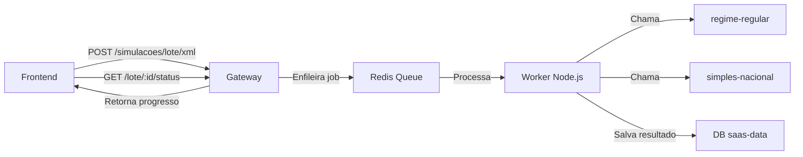

# Documento de Implementação — 7 Telas Nexo Fiscal

**Versão:** 1.0  
**Data:** 2026-11-22  
**Autor:** Claude Code  
**Projeto:** rtc-saas  

---

## 1. Visão Geral

Este documento descreve a implementação das 7 telas definidas nos wireframes textuais para o sistema **Nexo Fiscal — Simulador CBS e IBS**, transformando o MVP atual (simulador item-a-item) em uma plataforma completa para escritórios de contabilidade.

### 1.1 Estado Atual do Sistema

| Componente | Tecnologia | Status |
|------------|------------|--------|
| Frontend | SPA vanilla JS (`gateway/public/index.html`) | ✅ Funcional (6 abas) |
| Gateway API | Node.js/Express (`gateway/src/`) | ✅ Funcional |
| Cálculo Regime Regular | Java/Spring Boot (`vendor/calculadora-rtc-regime-regular`) | ✅ Funcional |
| Cálculo Simples Nacional | Java/Spring Boot (`vendor/calculadora-rtc-simples-nacional`) | ✅ Funcional |
| Geração DANFSe | Go (`vendor/calculadora-rtc-gerador-danfse`) | ✅ Funcional |
| Deploy | Docker Compose (5 serviços) | ✅ Funcional |

### 1.2 Gap Analysis — Telas Faltantes

| Tela | Wireframe | Implementação Atual | Esforço Estimado |
|------|-----------|---------------------|------------------|
| **1. Seletor Multi-CNPJ** | ✅ Definido | ❌ Não existe | Alto |
| **2. Dashboard Executivo** | ✅ Definido | 🟡 Parcial (`aba-inicio`) | Médio |
| **3. Simulador em Lote Avançado** | ✅ Definido | 🟡 Parcial (`aba-lote`) | Alto |
| **4. Auditoria de Itens** | ✅ Definido | ❌ Não existe | Alto |
| **5. Relatório White-Label** | ✅ Definido | ❌ Não existe | Alto |
| **6. Central DANFSe** | ✅ Definido | 🟡 Parcial (`aba-nota`) | Médio |
| **7. Configurações/Assinatura** | ✅ Definido | 🟡 Parcial (`aba-conta`) | Médio |

---

## 2. Arquitetura da Solução

### 2.1 Frontend — SPA Única (Manter)

**Decisão:** Manter arquitetura vanilla JS em `index.html` (sem React/Vue) para:
- Zero build step, deploy simples
- Bundle atual ~75KB (HTML+CSS+JS) — aceitável
- Equipe pequena, curva de aprendizado zero

**Refatoração necessária:**
- Separar CSS → `styles.css` (cacheável)
- Separar JS → `app.js` + módulos ES6 (`components/`, `services/`, `utils/`)
- Adicionar Chart.js via CDN para gráficos
- Manter single-file para deploy, mas desenvolver em arquivos separados

### 2.2 Backend — Novos Endpoints Gateway

```yaml
# Novas rotas em gateway/src/app.js
/empresas                    # CRUD empresas do contador
/empresas/:cnpj/dashboard    # KPIs + dados gráfico
/simulacoes/lote/xml         # Upload XML/ZIP → processamento assíncrono
/simulacoes/lote/:id/status  # Polling de progresso
/simulacoes/lote/:id/itens   # Itens com erro/alerta (paginado)
/simulacoes/lote/:id/recalcular  # Recalcular itens corrigidos
/relatorios/:id              # Dados relatório comparativo
/relatorios/:id/pdf          # Gerar PDF white-label
/relatorios/:id/excel        # Exportar Excel
/danfse/lote                 # Gerar PDFs em lote (retorna ZIP)
/danfse/historico            # Histórico DANFSe
/assinatura/uso              # Uso CNPJs do plano
/assinatura/dados-escritorio # Logo, responsável, CRC
```

### 2.3 Processamento Assíncrono (Lote)

**Problema:** Processar 500+ notas XML sincronamente travaria o gateway (timeout 30s).

**Solução:** Worker separado + polling.



**Opções de Queue:**
| Opção | Prós | Contras |
|-------|------|---------|
| **Bull + Redis** (Recomendado) | Robusto, retry, dashboard, escala | +1 serviço Docker |
| **Array em memória** | Zero dependência | Não escala, perde jobs se restart |
| **pg-boss (PostgreSQL)** | Usa DB existente | Mais complexo |

**Recomendação:** **Bull + Redis** — adicionar ao `docker-compose.yml`.

---

## 3. Detalhamento por Tela

### 3.1 Tela 1 — Seletor de Empresas (Multi-CNPJ)

#### Fluxo
```
Login → Seletor Empresas → Dashboard (empresa ativa)
```

#### Componentes
```javascript
// Novo estado global
let empresaAtiva = null;  // { cnpj, razaoSocial, regime, ultimaSimulacao }
let empresas = [];        // Lista do contador

// Componentes
CompanySelectorModal     // Busca + botão [+ Cadastrar]
CompanyCard              // Card: nome, CNPJ, regime, última simulação, [Acessar]
QuickRegisterModal       // 3 campos: CNPJ (auto-preenchimento), Regime, [Salvar]
```

#### API Pública CNPJ (Auto-preenchimento)
```
GET https://receitaws.com.br/v1/cnpj/{cnpj}  // Ou CNPJ.ws, BrasilAPI
→ Retorna: razao_social, cnae_fiscal, endereço, etc.
```

#### Integração Auth
- JWT atual → adicionar claim `empresaId` (CNPJ ativo)
- Middleware `requireEmpresa` nas rotas que precisam de empresa selecionada
- Header `X-Empresa-Ativa` ou claim no token

---

### 3.2 Tela 2 — Dashboard Executivo

#### Layout
```
┌─────────────────────────────────────────────────────────────┐
│ [Empresa ▼]                                    [Nova Simulação] │
├─────────────────────────────────────────────────────────────┤
│ [KPI 1]  [KPI 2]  [KPI 3]  [KPI 4]                          │
│ Faturamento  Carga Atual  Projeção Reforma  Diferença       │
├─────────────────────────────────────────────────────────────┤
│ Gráfico Comparativo (Chart.js)                              │
│ ┌─────────┐ ┌─────────┐ ┌─────────┐                         │
│ │ Atual   │ │ Simples │ │ Regular │  (barras lado a lado)  │
│ └─────────┘ └─────────┘ └─────────┘                         │
├─────────────────────────────────────────────────────────────┤
│ ⚠ 14 itens com divergência na regra da Reforma [Revisar]   │
└─────────────────────────────────────────────────────────────┘
```

#### KPIs (Calculados no Backend)
```javascript
// GET /empresas/:cnpj/dashboard
{
  faturamentoAnalisado: { valor: 450000, qtdNotas: 120 },
  cargaAtual: { valor: 27000, percentual: 6.0 },
  projecaoReforma: { valor: 31500, percentual: 7.0 },
  diferenca: { valor: 4500, tipo: 'aumento' }, // ou 'reducao'
  alertas: [
    { tipo: 'divergencia_ncm', qtd: 14, mensagem: '...' }
  ],
  grafico: {
    labels: ['Jan','Fev','Mar',...],
    datasets: [
      { label: 'Atual', data: [...] },
      { label: 'Simples Novo', data: [...] },
      { label: 'Regular Novo', data: [...] }
    ]
  }
}
```

#### Gráfico — Chart.js Config
```javascript
new Chart(ctx, {
  type: 'bar',
  data: dashboard.grafico,
  options: {
    responsive: true,
    interaction: { mode: 'index', intersect: false },
    plugins: { legend: { position: 'top' } },
    scales: { y: { beginAtZero: true, ticks: { callback: v => 'R$ ' + v.toLocaleString() } } }
  }
});
```

---

### 3.3 Tela 3 — Simulador em Lote Avançado

#### Layout
```
┌─────────────────────────────────────────────────────────────┐
│ Simulador em Lote                              [Baixar Modelo] │
├─────────────────────────────────────────────────────────────┤
│ ┌─────────────────────────────────────────────────────────┐ │
│ │  📁 Arraste XMLs (NF-e/NFS-e), .ZIP ou CSV aqui         │ │
│ │  ou clique para selecionar                              │ │
│ │  Máx 500 notas • 50MB                                   │ │
│ └─────────────────────────────────────────────────────────┘ │
├─────────────────────────────────────────────────────────────┤
│ Cenários de Simulação:                                      │
│ ☑ Simular no Regime Atual da empresa (Simples Nacional)     │
☑ Simular também no Regime Alternativo (Lucro Presumido)      │
├─────────────────────────────────────────────────────────────┤
│ ████████████████████░░░░  68%  Processando nota 340/500...  │
│ Validando regras na calculadora oficial da Receita...       │
├─────────────────────────────────────────────────────────────┤
│ [Cancelar]                                    [Ver Resultados] │
└─────────────────────────────────────────────────────────────┘
```

#### DropZone — Multi-formato
```javascript
// Aceita:
// - application/xml, text/xml (.xml)
// - application/zip (.zip com múltiplos XMLs)
// - text/csv (.csv modelo)

const parseFile = async (file) => {
  if (file.name.endsWith('.zip')) return await parseZip(file);
  if (file.name.endsWith('.csv')) return await parseCsv(file);
  return await parseXml(file);
};
```

#### Progresso Real (Polling)
```javascript
// POST /simulacoes/lote/xml → { jobId: "uuid" }
// GET /simulacoes/lote/:jobId/status → 
{
  status: 'processing', // 'queued' | 'processing' | 'completed' | 'failed'
  progress: { total: 500, processados: 340, erros: 12 },
  etapa: 'validando_regras_cbs_ibs',
  tempoEstimado: 45 // segundos
}
```

#### Redirecionamento Automático
```javascript
if (resultado.temErros) {
  router.navigate('/auditoria', { jobId });
} else {
  router.navigate('/relatorio', { jobId });
}
```

---

### 3.4 Tela 4 — Auditoria e Saneamento de Itens

#### Layout
```
┌─────────────────────────────────────────────────────────────┐
│ Auditoria — Lote #abc-123          [Recalcular Todos Corrigidos] │
├─────────────────────────────────────────────────────────────┤
│ Filtros: [Todos (120)] [Com Erro (14)] [Validados (106)]   │
├─────────────────────────────────────────────────────────────┤
│ ┌───┬──────────┬─────────────┬────────┬──────────────────┬───────┐ │
│ │ Nº│ Nota     │ Prod/Serv   │ NCM    │ Motivo do Alerta │ Ação  │ │
│ ├───┼──────────┼─────────────┼────────┼──────────────────┼───────┤ │
│ │ 1 │ NF 1042  │ Consultoria │ 0000...│ Classificação    │ [Editar│ │
│ │   │          │ TI          │        │ incompatível     │ Recalc]│ │
│ ├───┼──────────┼─────────────┼────────┼──────────────────┼───────┤ │
│ │ 2 │ NF 1043  │ Carne bovina│ 0201...│ NCM inexistente  │ [Editar│ │
│ │   │          │             │        │ na tabela 2027   │ Recalc]│ │
│ └───┴──────────┴─────────────┴────────┴──────────────────┴───────┘ │
└─────────────────────────────────────────────────────────────┘
```

#### DataTable — Funcionalidades
- **Filtros** por status (tabs)
- **Ordenação** por coluna
- **Paginação** (server-side, 50 por página)
- **Edição Inline** (modal ou row-expansion):
  - Campo NCM/Código (com busca tipo-ahead)
  - Campo Classificação (select com validação `aplicavel`)
  - Campo Valor
  - Botão [Recalcular Item]
- **Ação em Massa**: Checkbox header → [Recalcular Selecionados]

#### API
```javascript
// GET /simulacoes/lote/:id/itens?status=erro&page=1&size=50
{
  itens: [
    { 
      notaNumero: '1042', 
      descricao: 'Consultoria TI', 
      codigo: '000000000', 
      classificacao: '200028',
      motivoAlerta: 'Classificação tributária incompatível com CBS',
      sugestaoClassificacao: '200015', // da API aplicavel
      status: 'erro'
    }
  ],
  total: 14,
  page: 1,
  totalPages: 1
}

// POST /simulacoes/lote/:id/recalcular
{ itens: [{ indice: 0, codigo: '122011200', classificacao: '200015', valor: '1200' }] }
```

---

### 3.5 Tela 5 — Relatório Comparativo & Exportação White-Label

#### Layout
```
┌─────────────────────────────────────────────────────────────┬──────────────────┐
│                         RELATÓRIO                           │  PERSONALIZAÇÃO  │
│ ┌─────────┬───────────────────────────────────────────────┐ │  ┌────────────┐  │
│ │ Resumo  │ Memória de Cálculo                            │ │  │  [Logo]    │  │
│ │ Executivo│ (aba ativa)                                   │ │  │  Upload    │  │
│ └─────────┴───────────────────────────────────────────────┘ │  ├────────────┤  │
│                                                              │  │ Parecer do │  │
│  Aba 1: Resumo Executivo                                    │  │ Contador   │  │
│  ┌─────────────────────────────────────────────────────┐   │  │ [textarea] │  │
│  │ Gráfico de Impacto (Chart.js)                       │   │  ├────────────┤  │
│  │ Recomendação: "Simples Nacional economiza R$ 4.500" │   │  │ [Baixar    │  │
│  │ Cards: Economia Total, % Redução, Melhor Regime     │   │  │  PDF]      │  │
│  └─────────────────────────────────────────────────────┘   │  │ [Exportar  │  │
│                                                              │  │  Excel]    │  │
│  Aba 2: Memória de Cálculo Detalhada                        │  └────────────┘  │
│  ┌────┬────────┬───────┬──────┬──────┬──────┬──────┬─────┐  │                  │
│  │Nota│ Item   │ Base  │ CBS  │ IBS  │ IS   │ Total│Lei  │  │                  │
│  ├────┼────────┼───────┼──────┼──────┼──────┼──────┼─────┤  │                  │
│  │1042│Consult.│1200   │15.60 │18.00 │0.00  │33.60 │LC116│  │                  │
│  └────┴────────┴───────┴──────┴──────┴──────┴──────┴─────┘  │                  │
└─────────────────────────────────────────────────────────────┴──────────────────┘
```

#### Geração PDF White-Label
**Opção A: Puppeteer (Recomendada)**
- Renderiza HTML + CSS → PDF pixel-perfect
- Suporta logo, quebras de página, rodapé com CRC
- Adiciona ~150MB na imagem Docker

**Opção B: jsPDF (Client-side)**
- Zero backend, mas limitado (tabelas complexas, fontes)
- Não recomendado para relatório oficial

**Implementação Puppeteer:**
```javascript
// gateway/src/pdf.js
const puppeteer = require('puppeteer');

async function gerarRelatorioPDF(dados, personalizacao) {
  const browser = await puppeteer.launch({ args: ['--no-sandbox'] });
  const page = await browser.newPage();
  
  const html = renderRelatorioHTML(dados, personalizacao); // template
  await page.setContent(html, { waitUntil: 'networkidle0' });
  
  const pdf = await page.pdf({
    format: 'A4',
    printBackground: true,
    margin: { top: '20mm', bottom: '25mm', left: '15mm', right: '15mm' },
    displayHeaderFooter: true,
    headerTemplate: `<div style="width:100%;text-align:center;font-size:8px">${personalizacao.escritorioNome}</div>`,
    footerTemplate: `<div style="width:100%;text-align:center;font-size:8px">Página <span class="pageNumber"></span> de <span class="totalPages"></span> | ${personalizacao.responsavelTecnico} - CRC ${personalizacao.crc}</div>`
  });
  
  await browser.close();
  return pdf;
}
```

#### Exportação Excel
```javascript
// gateway/src/excel.js
const ExcelJS = require('exceljs');

async function gerarExcelRelatorio(dados) {
  const wb = new ExcelJS.Workbook();
  const ws = wb.addWorksheet('Memória de Cálculo');
  
  ws.columns = [
    { header: 'Nº Nota', key: 'nota', width: 12 },
    { header: 'Item', key: 'item', width: 30 },
    { header: 'Base', key: 'base', width: 15, style: { numFmt: '#,##0.00' } },
    { header: 'CBS', key: 'cbs', width: 15, style: { numFmt: '#,##0.00' } },
    { header: 'IBS', key: 'ibs', width: 15, style: { numFmt: '#,##0.00' } },
    { header: 'IS', key: 'is', width: 15, style: { numFmt: '#,##0.00' } },
    { header: 'Total', key: 'total', width: 15, style: { numFmt: '#,##0.00' } },
    { header: 'Base Legal', key: 'lei', width: 20 }
  ];
  
  dados.itens.forEach(i => ws.addRow(i));
  return await wb.xlsx.writeBuffer();
}
```

---

### 3.6 Tela 6 — Central de DANFSe (Motor Go)

#### Layout
```
┌─────────────────────────────────────────────────────────────┐
│ Central de DANFSe                                             │
├─────────────────────────────────────────────────────────────┤
│ ┌─────────────────────────────────────────────────────────┐ │
│ │ Opção A — Em Lote                                       │ │
│ │ "Suba os XMLs autorizados de NFS-e para gerar PDFs"    │ │
│ │ [📁 Selecionar ZIP/XMLs]  [Gerar ZIP com PDFs]          │ │
│ └─────────────────────────────────────────────────────────┘ │
├─────────────────────────────────────────────────────────────┤
│ ┌─────────────────────────────────────────────────────────┐ │
│ │ Opção B — Avulso                                        │ │
│ │ [Prestador: CNPJ, Nome, Endereço]                       │ │
│ │ [Tomador: CNPJ/CPF, Nome, Endereço]                     │ │
│ │ [Serviço: Descrição, Valor, CNAE, ISS]                  │ │
│ │ [Gerar Prévia DANFSe]                                   │ │
│ └─────────────────────────────────────────────────────────┘ │
├─────────────────────────────────────────────────────────────┤
│ Histórico Recente                              [Filtrar]    │
│ ┌────┬──────────┬────────────┬─────────┬────────┬──────────┐ │
│ │Data│ Tipo     │ Prestador  │ Tomador │ Status │ Ações    │ │
│ ├────┼──────────┼────────────┼─────────┼────────┼──────────┤ │
│ │22/11│ Lote   │ Escritório │ Vários  │ ✅ Pronto│ [⬇ ZIP] [📧]│ │
│ │21/11│ Avulso   │ Empresa A  │ Cliente │ ✅ Pronto│ [👁 PDF] [📧]│ │
│ └────┴──────────┴────────────┴─────────┴────────┴──────────┘ │
└─────────────────────────────────────────────────────────────┘
```

#### API DANFSe Lote (Novo)
```javascript
// POST /danfse/lote  (multipart/form-data: files[] + canhoto + situacao)
// → Processa via serviço Go existente, retorna ZIP
// GET /danfse/historico?limite=50
// POST /danfse/:id/email  { destinatario, assunto, mensagem }
```

#### Integração Serviço Go
- Já existe `calculadora-rtc-gerador-danfse` na porta 8080
- Estender para aceitar múltiplos XMLs → retorna ZIP
- Manter compatibilidade com endpoint atual `/v1/danfse`

---

### 3.7 Tela 7 — Configurações & Assinatura

#### Layout
```
┌─────────────────────────────────────────────────────────────┐
│ Configurações & Assinatura                                    │
├─────────────────────────────────────────────────────────────┤
│ ████████████░░░░░░░░░░  12/15 CNPJs usados  (Plano Escritório) │
│                                                    [Aumentar] │
├─────────────────────────────────────────────────────────────┤
│ ┌─────────────────────────────────────────────────────────┐ │
│ │ Dados do Escritório (aparecem nos relatórios/PDFs)      │ │
│ │ [Logo] [Upload]          Preview: [logo]                │ │
│ │ [Nome do Escritório]    "Sousa Contabilidade Ltda"      │ │
│ │ [Responsável Técnico]   "João Sousa"                    │ │
│ │ [CRC]                   "1SP123456/O-7"                 │ │
│ │ [E-mail Contato]        "contato@sousa.com.br"          │ │
│ │ [Salvar]                                                 │ │
│ └─────────────────────────────────────────────────────────┘ │
├─────────────────────────────────────────────────────────────┤
│ ┌─────────────────────────────────────────────────────────┐ │
│ │ Chaves de API (Integração)                              │ │
│ │ [Nome da Chave] [Criar] → Modal: "Copie agora: sk_..."  │ │
│ │ Tabela: Nome | Último Uso | [Revogar]                   │ │
│ └─────────────────────────────────────────────────────────┘ │
└─────────────────────────────────────────────────────────────┘
```

#### API
```javascript
// GET /assinatura/uso → { plano: 'escritorio', cnpjsUsados: 12, cnpjsLimite: 15 }
// PUT /assinatura/dados-escritorio → { logo: base64, nome, responsavel, crc, email }
// GET/POST/DELETE /keys (já existe, manter)
```

---

## 4. Modelo de Dados — Novas Entidades

### 4.1 Empresa (Contador → Clientes)
```sql
-- Tabela: empresas (SQLite em saas-data)
CREATE TABLE empresas (
  cnpj TEXT PRIMARY KEY,           -- 14 dígitos, só números
  razao_social TEXT NOT NULL,
  nome_fantasia TEXT,
  regime_atual TEXT NOT NULL,      -- 'simples-nacional' | 'lucro-presumido' | 'lucro-real'
  cnae_principal TEXT,             -- 7 dígitos
  endereco_json TEXT,              -- JSON com endereço completo
  contador_id TEXT NOT NULL,       -- FK para usuário (contador)
  created_at DATETIME DEFAULT CURRENT_TIMESTAMP,
  updated_at DATETIME DEFAULT CURRENT_TIMESTAMP,
  ultima_simulacao_at DATETIME
);

CREATE INDEX idx_empresas_contador ON empresas(contador_id);
```

### 4.2 Lote de Simulação
```sql
CREATE TABLE simulacoes_lote (
  id TEXT PRIMARY KEY,             -- UUID
  empresa_cnpj TEXT NOT NULL,      -- FK empresas
  contador_id TEXT NOT NULL,
  arquivo_original_nome TEXT,
  arquivo_original_tipo TEXT,      -- 'xml' | 'zip' | 'csv'
  cenarios TEXT NOT NULL,          -- JSON: ['regime-atual', 'regime-alternativo']
  status TEXT DEFAULT 'queued',    -- 'queued' | 'processing' | 'completed' | 'failed' | 'cancelled'
  total_notas INTEGER DEFAULT 0,
  processadas INTEGER DEFAULT 0,
  com_erro INTEGER DEFAULT 0,
  resultado_json TEXT,             -- JSON com totais por cenário
  erro_mensagem TEXT,
  created_at DATETIME DEFAULT CURRENT_TIMESTAMP,
  started_at DATETIME,
  completed_at DATETIME
);

CREATE INDEX idx_lote_contador ON simulacoes_lote(contador_id, created_at DESC);
```

### 4.3 Itens de Lote (para Auditoria)
```sql
CREATE TABLE lote_itens (
  id TEXT PRIMARY KEY,
  lote_id TEXT NOT NULL,           -- FK simulacoes_lote
  nota_numero TEXT,
  nota_data TEXT,
  item_indice INTEGER,             -- índice dentro da nota
  descricao TEXT,
  codigo TEXT,                     -- NCM ou NBS
  classificacao TEXT,              -- cClassTrib
  valor REAL,
  regime TEXT,                     -- cenário simulado
  status TEXT,                     -- 'calculado' | 'erro' | 'alerta'
  mensagens TEXT,                  -- JSON array
  cbs REAL, ibs REAL, is REAL, total REAL,
  base_legal TEXT,                 -- lei retornada pela calculadora
  created_at DATETIME DEFAULT CURRENT_TIMESTAMP
);

CREATE INDEX idx_lote_itens_lote ON lote_itens(lote_id);
CREATE INDEX idx_lote_itens_status ON lote_itens(lote_id, status);
```

### 4.4 Dados do Escritório (White-Label)
```sql
CREATE TABLE escritorio_config (
  contador_id TEXT PRIMARY KEY,    -- FK usuário
  logo_base64 TEXT,                -- PNG/JPG, max 500KB
  nome TEXT NOT NULL,
  responsavel_tecnico TEXT,
  crc TEXT,
  email_contato TEXT,
  updated_at DATETIME DEFAULT CURRENT_TIMESTAMP
);
```

---

## 5. Mudanças no Docker Compose

```yaml
# docker-compose.yml — Adições
services:
  # ... serviços existentes ...
  
  redis:
    image: redis:7-alpine
    mem_limit: ${MEM_REDIS:-128m}
    volumes:
      - redis-data:/data
    restart: unless-stopped
    command: redis-server --appendonly yes --maxmemory 100mb --maxmemory-policy allkeys-lru

  worker-lote:
    build: ./gateway
    command: node src/worker-lote.js
    mem_limit: ${MEM_WORKER:-512m}
    environment:
      NODE_OPTIONS: "--max-old-space-size=384"
      REDIS_URL: redis://redis:6379
      UPSTREAM_REGIME_REGULAR: http://regime-regular:8080
      UPSTREAM_SIMPLES_NACIONAL: http://simples-nacional:8082
      UPSTREAM_DANFSE: http://danfse:8080
    volumes:
      - saas-data:/data
    depends_on: [redis, regime-regular, simples-nacional, danfse]
    restart: unless-stopped

  # Gateway precisa de Puppeteer para PDF
  gateway:
    # ... existente ...
    # Adicionar no Dockerfile: RUN apk add --no-cache chromium nss freetype harfbuzz
    # ENV PUPPETEER_EXECUTABLE_PATH=/usr/bin/chromium-browser

volumes:
  # ... existentes ...
  redis-data:
```

**Dockerfile.gateway (atualização para Puppeteer):**
```dockerfile
FROM node:20-alpine
# Chromium para Puppeteer
RUN apk add --no-cache \
    chromium \
    nss \
    freetype \
    harfbuzz \
    ca-certificates \
    ttf-freefont
ENV PUPPETEER_EXECUTABLE_PATH=/usr/bin/chromium-browser
ENV PUPPETEER_SKIP_CHROMIUM_DOWNLOAD=true
# ... resto do Dockerfile
```

---

## 6. Segurança e Autorização

### 6.1 Multi-Tenancy (Contador ↔ Empresas)
```javascript
// Middleware gateway/src/auth.js
function requireEmpresa(req, res, next) {
  const empresaId = req.headers['x-empresa-ativa'] || req.user?.empresaAtiva;
  if (!empresaId) {
    return res.status(400).json({ erro: { mensagem: 'Nenhuma empresa selecionada' } });
  }
  // Verificar se contador tem acesso à empresa
  if (!req.user.empresas.includes(empresaId)) {
    return res.status(403).json({ erro: { mensagem: 'Acesso negado a esta empresa' } });
  }
  req.empresaId = empresaId;
  next();
}

// Aplicar em rotas que precisam de empresa
app.get('/empresas/:cnpj/dashboard', requireAuth, requireEmpresa, dashboardController);
app.post('/simulacoes/lote/xml', requireAuth, requireEmpresa, loteController.upload);
```

### 6.2 Rate Limiting (Lote)
```javascript
// gateway/src/rateLimit.js
const rateLimit = require('express-rate-limit');

const loteLimiter = rateLimit({
  windowMs: 60 * 60 * 1000, // 1 hora
  max: 10, // 10 lotes por hora por contador
  message: { erro: { mensagem: 'Limite de processamento em lote excedido. Tente novamente em 1 hora.' } },
  keyGenerator: (req) => req.user.id
});

app.post('/simulacoes/lote/xml', requireAuth, requireEmpresa, loteLimiter, loteController.upload);
```

---

## 7. Cronograma Detalhado

### Semana 1 — Fundação + Tela 1
| Dia | Entrega |
|-----|---------|
| 1 | Refatorar `index.html` → `styles.css` + `app.js` + módulos ES6; adicionar Chart.js |
| 2 | Criar `CompanySelector` + `QuickRegisterModal` + estado `empresaAtiva` |
| 3 | Endpoints `/empresas` (CRUD) + migração SQLite + auto-preenchimento CNPJ |
| 4 | Integrar Seletor no fluxo de login → Dashboard |
| 5 | Testes + ajustes responsivos + dark mode básico |

### Semana 2 — Dashboard (Tela 2) + Lote Básico (Tela 3)
| Dia | Entrega |
|-----|---------|
| 6 | Endpoint `/empresas/:cnpj/dashboard` + KPIs reais |
| 7 | `aba-dashboard` com 4 KPIs + Chart.js gráfico comparativo |
| 8 | Alertas de divergência + navegação para Auditoria |
| 9 | DropZone multi-formato (XML/ZIP/CSV) + parsing |
| 10 | Worker Bull + Redis + endpoints lote + polling progresso |

### Semana 3 — Lote Avançado + Auditoria (Telas 3, 4)
| Dia | Entrega |
|-----|---------|
| 11 | Cenários comparativos (regime atual + alternativo) |
| 12 | Redirecionamento automático baseado em erros |
| 13 | `aba-auditoria` DataTable com filtros, paginação, ordenação |
| 14 | Edição inline + recálculo item + recálculo em massa |
| 15 | Testes integração lote → auditoria → relatório |

### Semana 4 — Relatório White-Label + DANFSe (Telas 5, 6)
| Dia | Entrega |
|-----|---------|
| 16 | `aba-relatorio` estrutura abas + painel lateral |
| 17 | Puppeteer no gateway + template HTML→PDF white-label |
| 18 | Exportação Excel (ExcelJS) |
| 19 | `aba-danfse` lote (ZIP→ZIP) + avulso + histórico |
| 20 | Envio e-mail DANFSe (nodemailer ou serviço externo) |

### Semana 5 — Configurações + Polimento (Tela 7 + Qualidade)
| Dia | Entrega |
|-----|---------|
| 21 | `aba-configuracoes` uso CNPJs + dados escritório + logo upload |
| 22 | Dark mode completo (`prefers-color-scheme`) |
| 23 | Acessibilidade: ARIA tabs, focus-visible, contraste WCAG AA |
| 24 | Testes E2E (Playwright) — fluxos críticos |
| 25 | Bug fixes, performance, documentação, deploy staging |

---

## 8. Riscos e Mitigações

| Risco | Probabilidade | Impacto | Mitigação |
|-------|---------------|---------|-----------|
| Puppeteer + Chromium aumenta imagem Docker >1GB | Alta | Médio | Usar `chromium` Alpine (150MB) + `--no-sandbox`; considerar PDF client-side se crítico |
| Processamento lote 500 notas > 30s (timeout gateway) | Alta | Alto | **Worker assíncrono + polling** (já planejado) |
| API pública CNPJ (ReceitaWS) instável/rate-limited | Média | Médio | Cache local (24h) + fallback BrasilAPI/CNPJ.ws; permitir preenchimento manual |
| Chart.js bundle size (~60KB gz) | Baixa | Baixo | Carregar lazy (dynamic import) só na aba Dashboard |
| Migração dados existentes (simulações antigas) | Média | Médio | Script de migração: associar simulações históricas à primeira empresa do contador |
| Contador com 50+ empresas → performance seletor | Baixa | Baixo | Paginação/virtualização no `CompanySelector`; debounce busca |

---

## 9. Definição de Pronto (Definition of Done)

Para cada tela:
- [ ] Funcionalidade completa conforme wireframe
- [ ] Responsivo (mobile ≤640px, tablet 641-1024px, desktop >1024px)
- [ ] Dark mode funcional
- [ ] Acessibilidade: navegação teclado, ARIA labels, contraste ≥4.5:1
- [ ] Tratamento de erros (rede, validação, servidor) com feedback visual
- [ ] Loading states (skeleton, spinner, progress bar)
- [ ] Testes E2E cobrindo happy path + 1 erro
- [ ] Código revisado (ESLint + Prettier)
- [ ] Documentado no README (como usar)

---

## 10. Próximos Passos Imediatos

1. **Aprovação deste documento** — Confirmar escopo, priorização, decisões técnicas
2. **Setup ambiente** — Adicionar Redis + Worker no `docker-compose.yml` local
3. **Iniciar Fase 1** — Refatorar frontend + Seletor Multi-CNPJ
4. **Reunião semanal** — Sync de progresso, ajustes de rota

---

## Apêndice A — Estrutura de Arquivos Proposta (Pós-Refatoração)

```
gateway/
├── public/
│   ├── index.html          # Entry point (carrega CSS/JS)
│   ├── styles.css          # Todo CSS extraído
│   ├── app.js              # Bootstrap + router + estado global
│   └── components/
│       ├── CompanySelector.js
│       ├── Dashboard.js
│       ├── LoteSimulador.js
│       ├── Auditoria.js
│       ├── Relatorio.js
│       ├── DanfseCentral.js
│       ├── Configuracoes.js
│       ├── DataTable.js
│       ├── DropZone.js
│       ├── ProgressBar.js
│       ├── Modal.js
│       └── KPICard.js
├── src/
│   ├── index.js            # Express setup
│   ├── auth.js             # JWT + requireEmpresa
│   ├── empresas.js         # CRUD empresas
│   ├── dashboard.js        # KPIs + gráfico
│   ├── lote.js             # Upload + status + itens + recalcular
│   ├── relatorio.js        # Dados + PDF + Excel
│   ├── danfse.js           # Lote + histórico + email
│   ├── configuracoes.js    # Uso plano + escritório
│   ├── worker-lote.js      # Processador Bull
│   ├── pdf.js              # Puppeteer templates
│   ├── excel.js            # ExcelJS export
│   ├── db.js               # SQLite helpers
│   ├── upstream.js         # Proxy para serviços Java/Go
│   └── rateLimit.js
├── test/
│   ├── e2e/                # Playwright tests
│   └── unit/
├── Dockerfile
└── package.json
```

---

## Apêndice B — Dependências Novas (package.json)

```json
{
  "dependencies": {
    "chart.js": "^4.4.0",
    "bull": "^4.12.0",
    "ioredis": "^5.3.0",
    "puppeteer": "^22.0.0",
    "exceljs": "^4.4.0",
    "nodemailer": "^6.9.0",
    "axios": "^1.6.0"
  },
  "devDependencies": {
    "@playwright/test": "^1.40.0",
    "eslint": "^8.50.0",
    "prettier": "^3.0.0"
  }
}
```

---

**Fim do Documento**