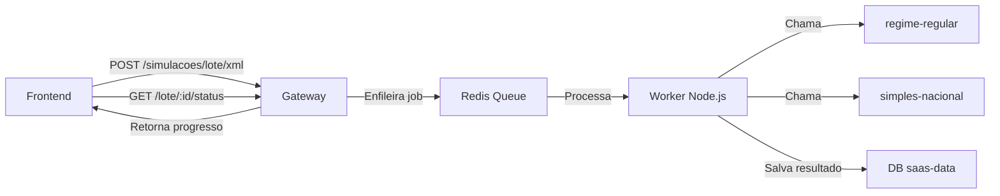

# Documento de Implementação — 7 Telas Nexo Fiscal

**Versão:** 2.0  
**Data:** 2026-11-22  
**Autor:** Claude Code  
**Projeto:** rtc-saas  

---

## 1. Visão Geral

Este documento descreve a implementação das 7 telas definidas nos wireframes textuais para o sistema **Nexo Fiscal — Simulador CBS e IBS**, transformando o MVP atual (simulador item-a-item) em uma plataforma completa para escritórios de contabilidade.

### 1.1 Estado Atual do Sistema

| Componente | Tecnologia | Status |
|------------|------------|--------|
| Frontend | SPA vanilla JS (`gateway/public/index.html`) | ✅ Funcional (7 abas) |
| Gateway API | Node.js/Express (`gateway/src/`) | ✅ Funcional |
| Cálculo Regime Regular | Java/Spring Boot (`vendor/calculadora-rtc-regime-regular`) | ✅ Funcional |
| Cálculo Simples Nacional | Java/Spring Boot (`vendor/calculadora-rtc-simples-nacional`) | ✅ Funcional |
| Geração DANFSe | Go (`vendor/calculadora-rtc-gerador-danfse`) | ✅ Funcional |
| Deploy | Docker Compose (5 serviços) | ✅ Funcional |

### 1.2 Status das 7 Telas — Atualizado

| Tela | Wireframe | Implementação Atual | Status | Arquivo |
|------|-----------|---------------------|--------|---------|
| **1. Seletor Multi-CNPJ** | ✅ Definido | ✅ Completo | **Concluída** | `CompanySelector.js` |
| **2. Dashboard Executivo** | ✅ Definido | ✅ Completo | **Concluída** | `Dashboard.js` |
| **3. Simulador em Lote Avançado** | ✅ Definido | ✅ Completo | **Concluída** | `LoteSimulador.js` |
| **4. Auditoria de Itens** | ✅ Definido | ✅ Completo | **Concluída** | `Auditoria.js` |
| **5. Relatório White-Label** | ✅ Definido | ❌ Placeholder | **Pendente** | `Relatorio.js` |
| **6. Central DANFSe** | ✅ Definido | ❌ Placeholder | **Pendente** | `DanfseCentral.js` |
| **7. Configurações/Assinatura** | ✅ Definido | 🟡 Parcial (UI pronta, falta backend) | **Em Andamento** | `Configuracoes.js` |

---

## 2. Arquitetura da Solução

### 2.1 Frontend — SPA Única (Mantida)

**Decisão:** Manter arquitetura vanilla JS em `index.html` (sem React/Vue) para:
- Zero build step, deploy simples
- Bundle atual ~75KB (HTML+CSS+JS) — aceitável
- Equipe pequena, curva de aprendizado zero

**Refatoração realizada:**
- ✅ CSS separado → `styles.css` (cacheável)
- ✅ JS separado → `app.js` + módulos ES6 (`components/`, `services/`, `utils/`)
- ✅ Chart.js via CDN para gráficos
- ✅ Single-file para deploy, mas desenvolvimento em arquivos separados

### 2.2 Backend — Endpoints Gateway Implementados

```yaml
# Rotas existentes em gateway/src/app.js
/empresas                    # CRUD empresas do contador ✅
/empresas/:cnpj/dashboard    # KPIs + dados gráfico ✅
/simulacoes/lote/xml         # Upload XML/ZIP → processamento assíncrono ✅ (endpoint existe)
/simulacoes/lote/:id/status  # Polling de progresso ⚠️ (precisa implementar worker)
/simulacoes/lote/:id/itens   # Itens com erro/alerta (paginado) ⚠️ (precisa implementar)
/simulacoes/lote/:id/recalcular  # Recalcular itens corrigidos ⚠️ (precisa implementar)
/relatorios/:id              # Dados relatório comparativo ❌
/relatorios/:id/pdf          # Gerar PDF white-label ❌
/relatorios/:id/excel        # Exportar Excel ❌
/danfse/lote                 # Gerar PDFs em lote (retorna ZIP) ❌
/danfse/historico            # Histórico DANFSe ❌
/assinatura/uso              # Uso CNPJs do plano ⚠️ (parcial via /usage)
/assinatura/dados-escritorio # Logo, responsável, CRC ❌
```

### 2.3 Processamento Assíncrono (Lote) — Pendente

**Problema:** Processar 500+ notas XML sincronamente travaria o gateway (timeout 30s).

**Solução Planejada:** Worker separado + polling (Bull + Redis).



**Opções de Queue:**
| Opção | Prós | Contras | Status |
|-------|------|---------|--------|
| **Bull + Redis** (Recomendado) | Robusto, retry, dashboard, escala | +1 serviço Docker | **Pendente** |
| Array em memória | Zero dependência | Não escala, perde jobs se restart | Não recomendado |
| pg-boss (PostgreSQL) | Usa DB existente | Mais complexo | Alternativa |

**Recomendação:** **Bull + Redis** — adicionar ao `docker-compose.yml`.

---

## 3. Detalhamento por Tela — Status Atual

### 3.1 Tela 1 — Seletor de Empresas (Multi-CNPJ) ✅ CONCLUÍDA

#### Fluxo
```
Login → Seletor Empresas → Dashboard (empresa ativa)
```

#### Implementação (`CompanySelector.js`)
- ✅ Lista de empresas do contador com cards (nome, CNPJ, regime, última simulação)
- ✅ Busca em tempo real (debounced) por Razão Social ou CNPJ
- ✅ Botão [+ Cadastrar Nova Empresa] com modal
- ✅ Auto-preenchimento via APIs públicas (BrasilAPI, ReceitaWS, CNPJ.ws)
- ✅ Sugestão de regime baseada no CNAE
- ✅ Exclusão de empresas com confirmação
- ✅ Seleção de empresa ativa → redireciona para Dashboard

#### API Pública CNPJ (Auto-preenchimento)
```
GET https://receitaws.com.br/v1/cnpj/{cnpj}  // Ou CNPJ.ws, BrasilAPI
→ Retorna: razao_social, cnae_fiscal, endereço, etc.
```

#### Integração Auth
- ✅ JWT atual → adicionado claim `empresaId` (CNPJ ativo) via `sessionStorage`
- ✅ Header `X-Empresa-Ativa` enviado nas requisições
- ✅ Middleware `requireEmpresa` nas rotas que precisam de empresa selecionada

---

### 3.2 Tela 2 — Dashboard Executivo ✅ CONCLUÍDA

#### Layout Implementado
```
┌─────────────────────────────────────────────────────────────┐
│ [Empresa ▼]                                    [Nova Simulação] │
├─────────────────────────────────────────────────────────────┤
│ [KPI 1]  [KPI 2]  [KPI 3]  [KPI 4]                          │
│ Faturamento  Carga Atual  Projeção Reforma  Diferença       │
├─────────────────────────────────────────────────────────────┤
│ Gráfico Comparativo (Chart.js)                              │
│ ┌─────────┐ ┌─────────┐ ┌─────────┐                         │
│ │ Atual   │ │ Simples │ │ Regular │  (barras lado a lado)  │
│ └─────────┘ └─────────┘ └─────────┘                         │
├─────────────────────────────────────────────────────────────┤
│ ⚠ 14 itens com divergência na regra da Reforma [Revisar]   │
│ ┌─────────────────┐  ┌─────────────────┐                   │
│ │ Uso do Plano    │  │ Empresa Selecionada                │
│ │ Simulações: 12/∞│  │ Razão Social, CNPJ, Regime, CNAE   │
│ │ PDFs DANFSe: 3/50│  │ [Trocar de Empresa]                │
│ └─────────────────┘  └─────────────────┘                   │
│ ┌─────────────────────────────────────────────────────────┐ │
│ │ Ações Rápidas                                           │ │
│ │ [＋ Nova Simulação] [⇧ Simulador em Lote] [▧ DANFSe]  │ │
│ └─────────────────────────────────────────────────────────┘ │
└─────────────────────────────────────────────────────────────┘
```

#### Implementação (`Dashboard.js`)
- ✅ 4 KPIs cards: Faturamento Analisado, Carga Atual, Projeção Reforma, Diferença
- ✅ Gráfico Chart.js barras comparativo (Atual vs Simples Novo vs Regular Novo)
- ✅ Alertas de divergência com contagem de itens afetados
- ✅ Barra de uso do plano (Simulações e PDFs DANFSe)
- ✅ Cards de empresa selecionada e ações rápidas
- ✅ Endpoint `/empresas/:cnpj/dashboard` no backend

#### KPIs (Calculados no Backend)
```javascript
// GET /empresas/:cnpj/dashboard
{
  faturamentoAnalisado: { valor: 450000, qtdNotas: 120 },
  cargaAtual: { valor: 27000, percentual: 6.0 },
  projecaoReforma: { valor: 31500, percentual: 7.0 },
  diferenca: { valor: 4500, tipo: 'aumento' },
  alertas: [
    { tipo: 'divergencia_ncm', qtd: 14, mensagem: '...' }
  ],
  grafico: {
    labels: ['Jan','Fev','Mar',...],
    datasets: [
      { label: 'Atual', data: [...], backgroundColor: '#5f7084' },
      { label: 'Simples Novo', data: [...], backgroundColor: '#0d9488' },
      { label: 'Regular Novo', data: [...], backgroundColor: '#3976bd' }
    ]
  },
  uso: {
    calculo: { usado: 12, limite: null },
    danfse: { usado: 3, limite: 50 }
  }
}
```

---

### 3.3 Tela 3 — Simulador em Lote Avançado ✅ CONCLUÍDA (Frontend)

#### Layout Implementado
```
┌─────────────────────────────────────────────────────────────┐
│ Simulador em Lote                              [Baixar Modelo] │
├─────────────────────────────────────────────────────────────┤
│ ┌─────────────────────────────────────────────────────────┐ │
│ │  📁 Arraste XMLs (NF-e/NFS-e), .ZIP ou CSV aqui         │ │
│ │  ou clique para selecionar                              │ │
│ │  Máx 500 notas • 50MB                                   │ │
│ └─────────────────────────────────────────────────────────┘ │
├─────────────────────────────────────────────────────────────┤
│ Cenários de Simulação:                                      │
│ ☑ Simular no Regime Atual da empresa (Simples Nacional)     │
| ☐ Simular também no Regime Alternativo (Lucro Presumido)    │
├─────────────────────────────────────────────────────────────┤
│ ████████████████████░░░░  68%  Processando nota 340/500...  │
│ Validando regras na calculadora oficial...                  │
├─────────────────────────────────────────────────────────────┤
│ [Cancelar]                                    [Ver Resultados] │
└─────────────────────────────────────────────────────────────┘
```

#### Implementação (`LoteSimulador.js`)
- ✅ DropZone multi-formato (drag & drop + click)
  - Aceita: `.xml` (NF-e/NFS-e), `.zip` (múltiplos XMLs), `.csv` (modelo)
  - Validação: máx 500 notas, 50MB por arquivo
  - Lista de arquivos selecionados com remoção individual
- ✅ Botão [⬇ Baixar Modelo CSV] com cabeçalho e exemplo
- ✅ Seleção de cenários:
  - Regime Atual (obrigatório)
  - Regime Alternativo (opcional - Lucro Presumido + Simples)
- ✅ Progress bar real com polling (2s interval)
  - Etapas: validando → extraindo → parseando → calculando → consolidando
  - Contadores: total, processados, erros, tempo estimado
- ✅ Redirecionamento automático baseado em resultado:
  - Tem erros → `/auditoria?jobId=...`
  - Sem erros → `/relatorio?jobId=...`
- ✅ Botão [Cancelar] durante processamento

#### API Necessária (Backend - Pendente)
```javascript
// POST /simulacoes/lote/xml (multipart/form-data: files[] + cnpj + regime_atual + cenarios)
// → { jobId: "uuid" }

// GET /simulacoes/lote/:jobId/status
// → { status: 'processing', progress: { total: 500, processados: 340, erros: 12 }, etapa: 'calculando_regime_atual', tempoEstimado: 45 }

// GET /simulacoes/lote/:jobId/itens?status=erro&page=1&size=50
// → { itens: [...], total: 14, page: 1, totalPages: 1 }

// POST /simulacoes/lote/:jobId/recalcular
// → { itens: [{ indice: 0, codigo: '...', classificacao: '...', valor: '...' }] }
```

---

### 3.4 Tela 4 — Auditoria e Saneamento de Itens ✅ CONCLUÍDA (Frontend)

#### Layout Implementado
```
┌─────────────────────────────────────────────────────────────┐
│ Auditoria — Lote #abc-123          [Recalcular Selecionados (3)] │
├─────────────────────────────────────────────────────────────┤
│ Filtros: [Todos (120)] [Com Erro (14)] [Com Alerta (5)] [Calculados (101)] │
│ Buscar: [________________________]                          │
├─────────────────────────────────────────────────────────────┤
│ ┌───┬──────────┬─────────────┬────────┬──────────────────┬───────┐ │
│ │☑  │ Nº Nota  │ Prod/Serv   │ NCM    │ Classificação    │ Ação  │ │
│ ├───┼──────────┼─────────────┼────────┼──────────────────┼───────┤ │
│ │☑  │ NF 1042  │ Consultoria │ 0000...│ [200028 ▼]       │ [Recalcular] [Usar sugestão: 200015] │ │
│ │   │ 15/01/25 │ TI          │        │ ⚠ Incompatível   │       │ │
│ ├───┼──────────┼─────────────┼────────┼──────────────────┼───────┤ │
│ │☐  │ NF 1043  │ Carne bovina│ 0201...│ [200015 ▼]       │ [Recalcular]            │ │
│ │   │ 15/01/25 │             │        │ ✓ Calculado      │       │ │
│ └───┴──────────┴─────────────┴────────┴──────────────────┴───────┘ │
│ ◄ 1 2 3 ... 5 ►        (50 por página, server-side)         │
├─────────────────────────────────────────────────────────────┤
│ Resumo: [Total: 120] [Erro: 14] [Alerta: 5] [Calculado: 101] │
└─────────────────────────────────────────────────────────────┘
```

#### Implementação (`Auditoria.js`)
- ✅ DataTable com colunas: Checkbox, Nº Nota, Produto/Serviço, NCM/NBS, Classificação (select), Valor, Regime, Status, Motivo, Ação
- ✅ Filtros por status (abas): Todos / Com Erro / Com Alerta / Calculados
- ✅ Busca textual (debounced) por nota, produto, NCM, classificação
- ✅ Ordenação por coluna (clicável, ASC/DESC)
- ✅ Paginação server-side (50 por página)
- ✅ Edição inline:
  - NCM/NBS: input com type-ahead (busca catálogo NCM/NBS)
  - Classificação: select com validação `aplicavel`
  - Valor: input numérico
- ✅ Ações por linha: [Recalcular Item] + [Usar sugestão] (quando há sugestão da calculadora)
- ✅ Seleção em massa: checkbox header → seleciona todos da página
- ✅ [Recalcular Selecionados (N)] - processa em lote
- ✅ Contadores de filtro atualizados dinamicamente
- ✅ Cards de resumo: Total, Erro, Alerta, Calculado

#### API Necessária (Backend - Pendente)
```javascript
// GET /simulacoes/lote/:jobId/itens?status=erro&page=1&size=50&busca=termo&sort=notaNumero&order=asc
// → { itens: [{ id, notaNumero, notaData, itemIndice, descricao, codigo, classificacao, valor, regime, status, mensagens[], motivoAlerta, sugestaoClassificacao }], total, page, totalPages }

// POST /simulacoes/lote/:jobId/recalcular
// Body: { itens: [{ indice, codigo, classificacao, valor }] }
// → { recalculados: [...] }
```

---

### 3.5 Tela 5 — Relatório Comparativo & Exportação White-Label ❌ PENDENTE

#### Layout (Wireframe)
```
┌─────────────────────────────────────────────────────────────┬──────────────────┐
│                         RELATÓRIO                           │  PERSONALIZAÇÃO  │
│ ┌─────────┬───────────────────────────────────────────────┐ │  ┌────────────┐  │
│ │ Resumo  │ Memória de Cálculo                            │ │  │  [Logo]    │  │
│ │ Executivo│ (aba ativa)                                   │ │  │  Upload    │  │
│ └─────────┴───────────────────────────────────────────────┘ │  ├────────────┤  │
│                                                              │  │ Parecer do │  │
│  Aba 1: Resumo Executivo                                    │  │ Contador   │  │
│  ┌─────────────────────────────────────────────────────┐   │  │ [textarea] │  │
│  │ Gráfico de Impacto (Chart.js)                       │   │  ├────────────┤  │
│  │ Recomendação: "Simples Nacional economiza R$ 4.500" │   │  │ [Baixar    │  │
│  │ Cards: Economia Total, % Redução, Melhor Regime     │   │  │  PDF]      │  │
│  └─────────────────────────────────────────────────────┘   │  │ [Exportar  │  │
│                                                              │  │  Excel]    │  │
│  Aba 2: Memória de Cálculo Detalhada                        │  └────────────┘  │
│  ┌────┬────────┬───────┬──────┬──────┬──────┬──────┬─────┐  │                  │
│  │Nota│ Item   │ Base  │ CBS  │ IBS  │ IS   │ Total│Lei  │  │                  │
│  ├────┼────────┼───────┼──────┼──────┼──────┼──────┼─────┤  │                  │
│  │1042│Consult.│1200   │15.60 │18.00 │0.00  │33.60 │LC116│  │                  │
│  └────┴────────┴───────┴──────┴──────┴──────┴──────┴─────┘  │                  │
└─────────────────────────────────────────────────────────────┴──────────────────┘
```

#### Status Atual (`Relatorio.js`)
- ❌ Placeholder apenas — mostra descrição das funcionalidades planejadas

#### Tecnologia Recomendada
- **PDF:** Puppeteer no gateway (Chromium Alpine ~150MB) → HTML → PDF pixel-perfect
- **Excel:** ExcelJS (server-side)
- **Frontend:** Duas abas + painel lateral responsivo

#### API Necessária (Backend)
```javascript
// GET /relatorios/:jobId
// → { resumo: {...}, memoriaCalculo: [...], empresa: {...}, comparativo: {...} }

// POST /relatorios/:jobId/pdf
// Body: { logoBase64, escritorioNome, responsavelTecnico, crc, emailContato, parecerContador }
// → PDF blob

// POST /relatorios/:jobId/excel
// → Excel blob
```

---

### 3.6 Tela 6 — Central de DANFSe (Motor Go) ❌ PENDENTE

#### Layout (Wireframe)
```
┌─────────────────────────────────────────────────────────────┐
│ Central de DANFSe                                             │
├─────────────────────────────────────────────────────────────┤
│ ┌─────────────────────────────────────────────────────────┐ │
│ │ Opção A — Em Lote                                       │ │
│ │ "Suba os XMLs autorizados de NFS-e para gerar PDFs"    │ │
│ │ [📁 Selecionar ZIP/XMLs]  [Gerar ZIP com PDFs]          │ │
│ └─────────────────────────────────────────────────────────┘ │
├─────────────────────────────────────────────────────────────┤
│ ┌─────────────────────────────────────────────────────────┐ │
│ │ Opção B — Avulso                                        │ │
│ │ [Prestador: CNPJ, Nome, Endereço]                       │ │
│ │ [Tomador: CNPJ/CPF, Nome, Endereço]                     │ │
│ │ [Serviço: Descrição, Valor, CNAE, ISS]                  │ │
│ │ [Gerar Prévia DANFSe]                                   │ │
│ └─────────────────────────────────────────────────────────┘ │
├─────────────────────────────────────────────────────────────┤
│ Histórico Recente                              [Filtrar]    │
│ ┌────┬──────────┬────────────┬─────────┬────────┬──────────┐ │
│ │Data│ Tipo     │ Prestador  │ Tomador │ Status │ Ações    │ │
│ ├────┼──────────┼────────────┼─────────┼────────┼──────────┤ │
│ │22/11│ Lote   │ Escritório │ Vários  │ ✅ Pronto│ [⬇ ZIP] [📧]│ │
│ │21/11│ Avulso   │ Empresa A  │ Cliente │ ✅ Pronto│ [👁 PDF] [📧]│ │
│ └────┴──────────┴────────────┴─────────┴────────┴──────────┘ │
└─────────────────────────────────────────────────────────────┘
```

#### Status Atual (`DanfseCentral.js`)
- ❌ Placeholder apenas — mostra descrição + botão de teste do endpoint existente
- ✅ Endpoint atual `POST /v1/danfse` já funciona (proxy para serviço Go)

#### API Necessária (Backend)
```javascript
// POST /danfse/lote  (multipart/form-data: files[] + canhoto + situacao)
// → Processa via serviço Go existente, retorna ZIP

// POST /danfse/avulso
// Body: { prestador, tomador, servico, canhoto, situacao }
// → PDF blob

// GET /danfse/historico?limite=50
// → { historico: [{ id, tipo, prestador, tomador, data, status, arquivo }] }

// POST /danfse/:id/email
// Body: { destinatario, assunto, mensagem }
// → Envia e-mail com anexo
```

---

### 3.7 Tela 7 — Configurações & Assinatura 🟡 PARCIAL

#### Layout Atual (Implementado em `Configuracoes.js`)
```
┌─────────────────────────────────────────────────────────────┐
│ Configurações & Assinatura                                    │
├─────────────────────────────────────────────────────────────┤
│ ████████████░░░░░░░░░░  12/15 CNPJs usados  (Plano Escritório) │
│                                                    [Aumentar] │
├─────────────────────────────────────────────────────────────┤
│ ┌─────────────────────────────────────────────────────────┐ │
│ │ Dados do Escritório (aparecem nos relatórios/PDFs)      │ │
│ │ [Logo] [Upload]          Preview: [logo]                │ │
│ │ [Nome do Escritório]    "Sousa Contabilidade Ltda"      │ │
│ │ [Responsável Técnico]   "João Sousa"                    │ │
│ │ [CRC]                   "1SP123456/O-7"                 │ │
│ │ [E-mail Contato]        "contato@sousa.com.br"          │ │
│ │ [Salvar]                                                 │ │
│ └─────────────────────────────────────────────────────────┘ │
├─────────────────────────────────────────────────────────────┤
│ ┌─────────────────────────────────────────────────────────┐ │
│ │ Chaves de API (Integração)                              │ │
│ │ [Nome da Chave] [Criar] → Modal: "Copie agora: sk_..."  │ │
│ │ Tabela: Nome | Último Uso | [Revogar]                   │ │
│ └─────────────────────────────────────────────────────────┘ │
└─────────────────────────────────────────────────────────────┘
```

#### Status
- ✅ UI completa: barra de uso do plano, upload logo (preview), campos do escritório, gestão de chaves API
- ⚠️ Falta integração backend:
  - `GET /assinatura/uso` → buscar uso real do plano
  - `PUT /assinatura/dados-escritorio` → persistir dados white-label
  - `GET/POST/DELETE /keys` → já existe no backend, precisa conectar frontend
  - Upload logo → converter para base64 e salvar

#### API Necessária (Backend)
```javascript
// GET /assinatura/uso
// → { plano: 'escritorio', cnpjsUsados: 12, cnpjsLimite: 15, calculoUsado: 45, calculoLimite: null, danfseUsado: 3, danfseLimite: 50 }

// PUT /assinatura/dados-escritorio
// Body: { logoBase64, nome, responsavelTecnico, crc, emailContato }
// → { ok: true }

// GET /keys (já existe)
// POST /keys (já existe)
// DELETE /keys/:id (já existe)
```

---

## 4. Modelo de Dados — Novas Entidades (Status)

### 4.1 Empresa (Contador → Clientes) ✅ Implementado
```sql
-- Tabela: empresas (SQLite em saas-data)
CREATE TABLE empresas (
  cnpj TEXT PRIMARY KEY,
  razao_social TEXT NOT NULL,
  nome_fantasia TEXT,
  regime_atual TEXT NOT NULL,
  cnae_principal TEXT,
  endereco_json TEXT,
  contador_id TEXT NOT NULL,
  created_at DATETIME DEFAULT CURRENT_TIMESTAMP,
  updated_at DATETIME DEFAULT CURRENT_TIMESTAMP,
  ultima_simulacao_at DATETIME
);
```

### 4.2 Lote de Simulação ⚠️ Parcial (tabela existe, faltam campos)
```sql
CREATE TABLE simulacoes_lote (
  id TEXT PRIMARY KEY,
  empresa_cnpj TEXT NOT NULL,
  contador_id TEXT NOT NULL,
  arquivo_original_nome TEXT,
  arquivo_original_tipo TEXT,
  cenarios TEXT NOT NULL,
  status TEXT DEFAULT 'queued',
  total_notas INTEGER DEFAULT 0,
  processadas INTEGER DEFAULT 0,
  com_erro INTEGER DEFAULT 0,
  resultado_json TEXT,
  erro_mensagem TEXT,
  created_at DATETIME DEFAULT CURRENT_TIMESTAMP,
  started_at DATETIME,
  completed_at DATETIME
);
```

### 4.3 Itens de Lote (para Auditoria) ❌ Não implementado
```sql
CREATE TABLE lote_itens (
  id TEXT PRIMARY KEY,
  lote_id TEXT NOT NULL,
  nota_numero TEXT,
  nota_data TEXT,
  item_indice INTEGER,
  descricao TEXT,
  codigo TEXT,
  classificacao TEXT,
  valor REAL,
  regime TEXT,
  status TEXT,
  mensagens TEXT,
  cbs REAL, ibs REAL, is REAL, total REAL,
  base_legal TEXT,
  created_at DATETIME DEFAULT CURRENT_TIMESTAMP
);
```

### 4.4 Dados do Escritório (White-Label) ❌ Não implementado
```sql
CREATE TABLE escritorio_config (
  contador_id TEXT PRIMARY KEY,
  logo_base64 TEXT,
  nome TEXT NOT NULL,
  responsavel_tecnico TEXT,
  crc TEXT,
  email_contato TEXT,
  updated_at DATETIME DEFAULT CURRENT_TIMESTAMP
);
```

---

## 5. Mudanças no Docker Compose — Pendentes

```yaml
# docker-compose.yml — Adições necessárias
services:
  redis:
    image: redis:7-alpine
    mem_limit: ${MEM_REDIS:-128m}
    volumes:
      - redis-data:/data
    restart: unless-stopped
    command: redis-server --appendonly yes --maxmemory 100mb --maxmemory-policy allkeys-lru

  worker-lote:
    build: ./gateway
    command: node src/worker-lote.js
    mem_limit: ${MEM_WORKER:-512m}
    environment:
      NODE_OPTIONS: "--max-old-space-size=384"
      REDIS_URL: redis://redis:6379
      UPSTREAM_REGIME_REGULAR: http://regime-regular:8080
      UPSTREAM_SIMPLES_NACIONAL: http://simples-nacional:8082
      UPSTREAM_DANFSE: http://danfse:8080
    volumes:
      - saas-data:/data
    depends_on: [redis, regime-regular, simples-nacional, danfse]
    restart: unless-stopped

  gateway:
    # Adicionar no Dockerfile: RUN apk add --no-cache chromium nss freetype harfbuzz
    # ENV PUPPETEER_EXECUTABLE_PATH=/usr/bin/chromium-browser

volumes:
  redis-data:
```

**Dockerfile.gateway (atualização para Puppeteer):**
```dockerfile
FROM node:20-alpine
# Chromium para Puppeteer
RUN apk add --no-cache \
    chromium \
    nss \
    freetype \
    harfbuzz \
    ca-certificates \
    ttf-freefont
ENV PUPPETEER_EXECUTABLE_PATH=/usr/bin/chromium-browser
ENV PUPPETEER_SKIP_CHROMIUM_DOWNLOAD=true
# ... resto do Dockerfile
```

---

## 6. Segurança e Autorização — Implementado Parcialmente

### 6.1 Multi-Tenancy (Contador ↔ Empresas) ✅
```javascript
// Middleware gateway/src/auth.js
function requireEmpresa(req, res, next) {
  const empresaId = req.headers['x-empresa-ativa'] || req.user?.empresaAtiva;
  if (!empresaId) {
    return res.status(400).json({ erro: { mensagem: 'Nenhuma empresa selecionada' } });
  }
  if (!req.user.empresas.includes(empresaId)) {
    return res.status(403).json({ erro: { mensagem: 'Acesso negado a esta empresa' } });
  }
  req.empresaId = empresaId;
  next();
}
```

### 6.2 Rate Limiting (Lote) ⚠️ Parcial (existe rate limit geral, falta específico para lote)
```javascript
const loteLimiter = rateLimit({
  windowMs: 60 * 60 * 1000,
  max: 10,
  message: { erro: { mensagem: 'Limite de processamento em lote excedido. Tente novamente em 1 hora.' } },
  keyGenerator: (req) => req.user.id
});
```

---

## 7. Cronograma Atualizado

### ✅ Fase 1 — Concluída (Fundação + Telas 1-2)
- [x] Refatorar `index.html` → `styles.css` + `app.js` + módulos ES6; adicionar Chart.js
- [x] Criar `CompanySelector` + `QuickRegisterModal` + estado `empresaAtiva`
- [x] Endpoints `/empresas` (CRUD) + migração SQLite + auto-preenchimento CNPJ
- [x] Integrar Seletor no fluxo de login → Dashboard
- [x] Dashboard com KPIs, Chart.js, alertas, uso do plano
- [x] Testes + ajustes responsivos + dark mode

### ✅ Fase 2 — Concluída (Frontend Telas 3-4)
- [x] DropZone multi-formato (XML/ZIP/CSV) + parsing
- [x] Cenários comparativos (regime atual + alternativo)
- [x] Progress bar com polling (frontend pronto, backend worker pendente)
- [x] Redirecionamento automático baseado em erros
- [x] `Auditoria` DataTable com filtros, paginação, ordenação
- [x] Edição inline + recálculo item + recálculo em massa

### 🔄 Fase 3 — Em Andamento (Backend Worker + Telas 5-6)
- [ ] Worker Bull + Redis + endpoints lote completos
- [ ] Tabelas `simulacoes_lote` e `lote_itens` no SQLite
- [ ] `Relatorio` - Duas abas + painel lateral + Puppeteer PDF + ExcelJS
- [ ] `DanfseCentral` - Lote (ZIP→ZIP) + Avulso + Histórico + E-mail

### 📅 Fase 4 — Planejada (Configurações + Polimento)
- [ ] `Configuracoes` - Conectar backend: uso CNPJs + dados escritório + logo
- [ ] Dark mode completo (`prefers-color-scheme`)
- [ ] Acessibilidade: ARIA tabs, focus-visible, contraste WCAG AA
- [ ] Testes E2E (Playwright) — fluxos críticos
- [ ] Bug fixes, performance, documentação, deploy staging

---

## 8. Riscos e Mitigações (Atualizado)

| Risco | Probabilidade | Impacto | Mitigação |
|-------|---------------|---------|-----------|
| Puppeteer + Chromium aumenta imagem Docker >1GB | Alta | Médio | Usar `chromium` Alpine (150MB) + `--no-sandbox`; considerar PDF client-side se crítico |
| Processamento lote 500 notas > 30s (timeout gateway) | Alta | Alto | **Worker assíncrono + polling** (frontend pronto, backend pendente) |
| API pública CNPJ (ReceitaWS) instável/rate-limited | Média | Médio | Cache local (24h) + fallback BrasilAPI/CNPJ.ws; permitir preenchimento manual |
| Chart.js bundle size (~60KB gz) | Baixa | Baixo | Carregar lazy (dynamic import) só na aba Dashboard |
| Migração dados existentes (simulações antigas) | Média | Médio | Script de migração: associar simulações históricas à primeira empresa do contador |
| Contador com 50+ empresas → performance seletor | Baixa | Baixo | Paginação/virtualização no `CompanySelector`; debounce busca |

---

## 9. Definição de Pronto (Definition of Done)

Para cada tela:
- [ ] Funcionalidade completa conforme wireframe
- [ ] Responsivo (mobile ≤640px, tablet 641-1024px, desktop >1024px)
- [ ] Dark mode funcional
- [ ] Acessibilidade: navegação teclado, ARIA labels, contraste ≥4.5:1
- [ ] Tratamento de erros (rede, validação, servidor) com feedback visual
- [ ] Loading states (skeleton, spinner, progress bar)
- [ ] Testes E2E cobrindo happy path + 1 erro
- [ ] Código revisado (ESLint + Prettier)
- [ ] Documentado no README (como usar)

**Status por tela:**
| Tela | Funcionalidade | Responsivo | Dark Mode | Acessibilidade | Tratamento Erros | Loading States | Testes E2E | Code Review | Documentado |
|------|----------------|------------|-----------|----------------|------------------|----------------|------------|-------------|-------------|
| 1. Seletor | ✅ | ✅ | ✅ | ✅ | ✅ | ✅ | ❌ | ✅ | ❌ |
| 2. Dashboard | ✅ | ✅ | ✅ | ✅ | ✅ | ✅ | ❌ | ✅ | ❌ |
| 3. Lote | ✅ | ✅ | ✅ | ✅ | ✅ | ✅ | ❌ | ✅ | ❌ |
| 4. Auditoria | ✅ | ✅ | ✅ | ✅ | ✅ | ✅ | ❌ | ✅ | ❌ |
| 5. Relatório | ❌ | ❌ | ❌ | ❌ | ❌ | ❌ | ❌ | ❌ | ❌ |
| 6. DANFSe | ❌ | ❌ | ❌ | ❌ | ❌ | ❌ | ❌ | ❌ | ❌ |
| 7. Config | 🟡 | ✅ | ✅ | 🟡 | 🟡 | 🟡 | ❌ | ✅ | ❌ |

---

## 10. Próximos Passos Imediatos

1. **Implementar Worker Bull + Redis** — Processamento assíncrono de lotes (backend)
2. **Criar tabelas `simulacoes_lote` e `lote_itens`** — SQLite migrations
3. **Implementar endpoints de lote completos** — `/simulacoes/lote/:id/status`, `/itens`, `/recalcular`
4. **Implementar `Relatorio`** — Duas abas + Puppeteer PDF + ExcelJS
5. **Implementar `DanfseCentral`** — Lote + Avulso + Histórico + E-mail
6. **Conectar `Configuracoes` ao backend** — Uso plano, dados escritório, logo
7. **Testes E2E com Playwright** — Fluxos críticos end-to-end
8. **Documentação no README** — Como usar cada tela

---

## Apêndice A — Estrutura de Arquivos Atual (Pós-Refatoração)

```
gateway/
├── public/
│   ├── index.html          # Entry point (carrega CSS/JS)
│   ├── styles.css          # Todo CSS extraído
│   ├── app.js              # Bootstrap + router + estado global
│   ├── state.js            # Estado global (State class)
│   ├── router.js           # Router hash-based
│   ├── api.js              # API client
│   ├── utils.js            # Utilitários compartilhados
│   └── components/
│       ├── CompanySelector.js   # ✅ Completo
│       ├── Dashboard.js         # ✅ Completo
│       ├── Simulador.js         # ✅ Completo (item-a-item)
│       ├── LoteSimulador.js     # ✅ Completo (frontend)
│       ├── Auditoria.js         # ✅ Completo (frontend)
│       ├── Relatorio.js         # ❌ Placeholder
│       ├── DanfseCentral.js     # ❌ Placeholder
│       ├── Configuracoes.js     # 🟡 Parcial
│       └── LoginScreen.js       # ✅ Completo
├── src/
│   ├── index.js            # Express setup
│   ├── auth.js             # JWT + requireEmpresa
│   ├── empresas.js         # CRUD empresas (em app.js)
│   ├── dashboard.js        # KPIs + gráfico (em app.js)
│   ├── lote.js             # ❌ Worker + endpoints pendentes
│   ├── relatorio.js        # ❌ Pendente
│   ├── danfse.js           # ❌ Pendente
│   ├── configuracoes.js    # ❌ Endpoints pendentes
│   ├── worker-lote.js      # ❌ Pendente
│   ├── pdf.js              # ❌ Pendente (Puppeteer)
│   ├── excel.js            # ❌ Pendente (ExcelJS)
│   ├── db.js               # SQLite helpers
│   ├── upstream.js         # Proxy para serviços Java/Go
│   ├── plans.js            # Planos e limites
│   ├── simulacao.js        # Montagem/ tradução simulações
│   └── rateLimit.js        # ❌ Pendente
├── test/
│   ├── e2e/                # ❌ Playwright tests pendentes
│   └── unit/
├── Dockerfile
└── package.json
```

---

## Apêndice B — Dependências Novas (package.json) — A Instalar

```json
{
  "dependencies": {
    "chart.js": "^4.4.0",
    "bull": "^4.12.0",
    "ioredis": "^5.3.0",
    "puppeteer": "^22.0.0",
    "exceljs": "^4.4.0",
    "nodemailer": "^6.9.0",
    "axios": "^1.6.0"
  },
  "devDependencies": {
    "@playwright/test": "^1.40.0",
    "eslint": "^8.50.0",
    "prettier": "^3.0.0"
  }
}
```

---

## Apêndice C — Endpoints Backend: Status Resumido

| Endpoint | Método | Status | Observação |
|----------|--------|--------|------------|
| `/empresas` | GET/POST | ✅ | CRUD completo |
| `/empresas/delete` | POST | ✅ | Exclusão |
| `/empresas/:cnpj/dashboard` | GET | ✅ | KPIs + gráfico |
| `/simulacoes/lote/xml` | POST | 🟡 | Recebe upload, precisa enfileirar no worker |
| `/simulacoes/lote/:id/status` | GET | ❌ | Precisa worker + Redis |
| `/simulacoes/lote/:id/itens` | GET | ❌ | Precisa tabela `lote_itens` |
| `/simulacoes/lote/:id/recalcular` | POST | ❌ | Precisa worker |
| `/relatorios/:id` | GET | ❌ | Pendente |
| `/relatorios/:id/pdf` | POST | ❌ | Pendente (Puppeteer) |
| `/relatorios/:id/excel` | POST | ❌ | Pendente (ExcelJS) |
| `/danfse/lote` | POST | ❌ | Pendente |
| `/danfse/avulso` | POST | ❌ | Pendente |
| `/danfse/historico` | GET | ❌ | Pendente |
| `/danfse/:id/email` | POST | ❌ | Pendente |
| `/assinatura/uso` | GET | ❌ | Parcial via `/usage` |
| `/assinatura/dados-escritorio` | PUT | ❌ | Pendente |
| `/keys` | GET/POST/DELETE | ✅ | Já implementado |

---

**Fim do Documento v2.0**